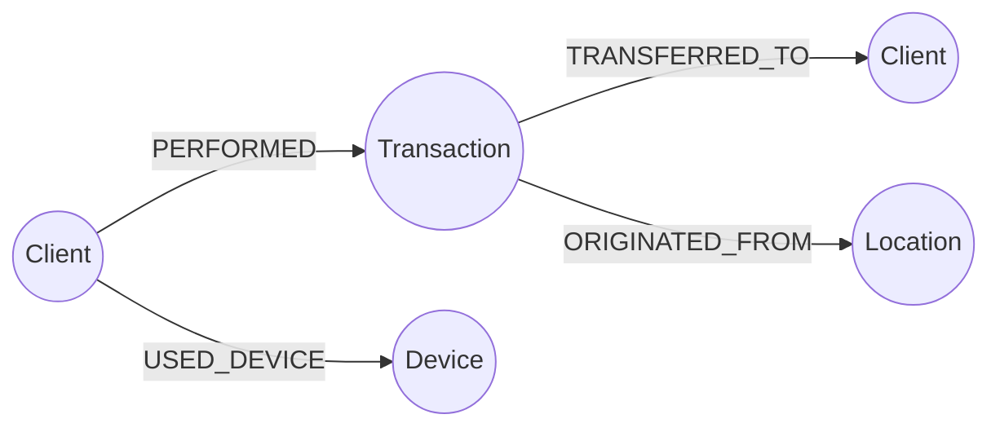

# Neo4j Graph Data Model Documentation

**Project:** Real-Time Graph-Based Financial Fraud Detection & Risk Analysis Platform  
**Academic Stage:** Review 2  
**Database:** Neo4j 5.x (Cypher / Bolt)  

---

## 1. Graph Schema Overview

The fraud detection engine models financial networks as a property graph containing 4 primary entity labels (Nodes) and 4 directional relationship types (Edges).



---

## 2. Node Definitions

### `Client`
Represents an individual account holder, merchant, or legal entity participating in financial transfers.

| Property | Type | Description | Constraints / Index |
|---|---|---|---|
| `client_id` | String | Unique identifier (e.g., `CLT001`) | **UNIQUE CONSTRAINT** |
| `name` | String | Legal name of account owner | |
| `email` | String | Primary email address | **INDEX** |
| `phone` | String | Primary contact number | |
| `account_type` | String | `savings`, `current`, `business` | |
| `account_balance` | Float | Account balance in INR | |
| `risk_score` | Float | Calibrated graph risk score (0–100) | **INDEX** |
| `is_flagged` | Boolean | True if marked as suspicious/fraudulent | |
| `kyc_verified` | Boolean | Verification status | |
| `created_at` | String (ISO 8601) | Account creation timestamp | |

### `Transaction`
Represents a distinct transfer of funds between two clients.

| Property | Type | Description | Constraints / Index |
|---|---|---|---|
| `transaction_id` | String | Unique identifier (e.g., `TXN0001`) | **UNIQUE CONSTRAINT** |
| `amount` | Float | Transaction amount | **INDEX** |
| `currency` | String | Currency code (e.g., `INR`) | |
| `status` | String | `completed`, `pending`, `failed` | **INDEX** |
| `transaction_type` | String | `transfer`, `payment`, `withdrawal` | |
| `channel` | String | `mobile_app`, `web`, `upi`, `atm` | |
| `is_fraud` | Boolean | True if confirmed/flagged as fraud | **INDEX** |
| `fraud_score` | Float | Calculated transaction anomaly score | |
| `timestamp` | String (ISO 8601) | Transaction execution time | **INDEX** |

### `Device`
Represents hardware or virtual clients used to initiate account operations.

| Property | Type | Description | Constraints / Index |
|---|---|---|---|
| `device_id` | String | Unique hardware/device ID (e.g., `DEV001`) | **UNIQUE CONSTRAINT** |
| `device_type` | String | `mobile`, `desktop`, `tablet` | |
| `os` | String | Operating system (`Android`, `iOS`, `Windows`, `Linux`) | |
| `ip_address` | String | Network IP associated with device | **INDEX** |
| `is_suspicious` | Boolean | Flagged if associated with fraud tools/VPNs | |

### `Location`
Represents geographic and network origin metadata for transactions.

| Property | Type | Description | Constraints / Index |
|---|---|---|---|
| `location_id` | String | Unique location ID (e.g., `LOC001`) | **UNIQUE CONSTRAINT** |
| `city` | String | Origin city | |
| `country` | String | Origin country | **INDEX** |
| `latitude` | Float | Geographic latitude coordinate | |
| `longitude` | Float | Geographic longitude coordinate | |
| `ip_address` | String (Optional) | Gateway IP | |
| `is_high_risk` | Boolean | Flagged if high-risk jurisdiction | |

---

## 3. Relationship Definitions

| Relationship | Source Label | Target Label | Description |
|---|---|---|---|
| `PERFORMED` | `Client` | `Transaction` | Indicates the client who originated and funded the transaction. |
| `TRANSFERRED_TO` | `Transaction` | `Client` | Indicates the recipient client of the transaction. |
| `USED_DEVICE` | `Client` | `Device` | Tracks which devices have authenticated or operated the client's account. |
| `ORIGINATED_FROM` | `Transaction` | `Location` | Captures geographic location where transaction was triggered. |

---

## 4. Key Graph Fraud Patterns & Cypher Queries

### A. Shared Device Fraud Ring
Detects multiple unrelated clients operating through the same device or IP address:
```cypher
MATCH (c1:Client)-[:USED_DEVICE]->(d:Device)<-[:USED_DEVICE]-(c2:Client)
WHERE c1.client_id < c2.client_id
RETURN d.device_id AS device_id, collect(DISTINCT c1.client_id) + collect(DISTINCT c2.client_id) AS client_ids
```

### B. Circular Fund Routing (Money Laundering Cycles)
Detects directed cycles (e.g., A → B → C → A) used in fund layering:
```cypher
MATCH (a:Client)-[:PERFORMED]->(t1:Transaction)-[:TRANSFERRED_TO]->(b:Client)
      -[:PERFORMED]->(t2:Transaction)-[:TRANSFERRED_TO]->(c:Client)
      -[:PERFORMED]->(t3:Transaction)-[:TRANSFERRED_TO]->(a)
WHERE a.client_id < b.client_id AND b.client_id < c.client_id
RETURN [a.client_id, b.client_id, c.client_id] AS cycle_clients,
       [t1.transaction_id, t2.transaction_id, t3.transaction_id] AS cycle_txns
```

### C. Multi-Hop Suspicious Traversal
Traces fund flows spanning 3 or more hops involving flagged entities:
```cypher
MATCH (a:Client)-[:PERFORMED]->(t1:Transaction)-[:TRANSFERRED_TO]->(b:Client)
      -[:PERFORMED]->(t2:Transaction)-[:TRANSFERRED_TO]->(c:Client)
      -[:PERFORMED]->(t3:Transaction)-[:TRANSFERRED_TO]->(d:Client)
WHERE a <> b AND b <> c AND c <> d
  AND (a.is_flagged OR b.is_flagged OR c.is_flagged OR d.is_flagged OR t1.is_fraud OR t2.is_fraud OR t3.is_fraud)
RETURN a.client_id, d.client_id, [t1.transaction_id, t2.transaction_id, t3.transaction_id] AS txns
```

### D. Velocity Anomaly
Detects rapid transaction bursts from the same client within a rolling 2-hour window:
```cypher
MATCH (c:Client)-[:PERFORMED]->(t:Transaction)
WHERE t.timestamp IS NOT NULL AND datetime(t.timestamp) >= datetime() - duration({hours: 2})
WITH c, count(t) AS txn_count, sum(t.amount) AS total_amount
WHERE txn_count >= 5
RETURN c.client_id, txn_count, total_amount ORDER BY txn_count DESC
```
