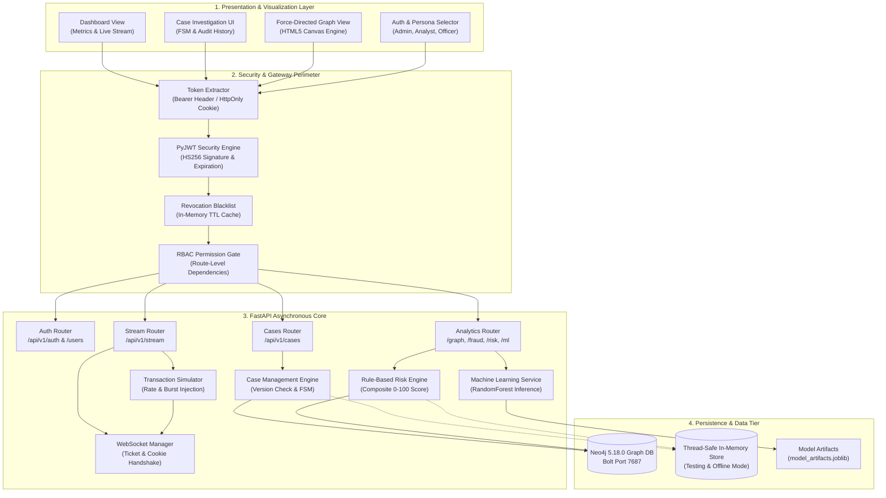
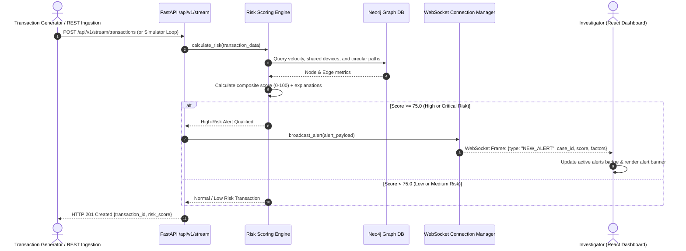
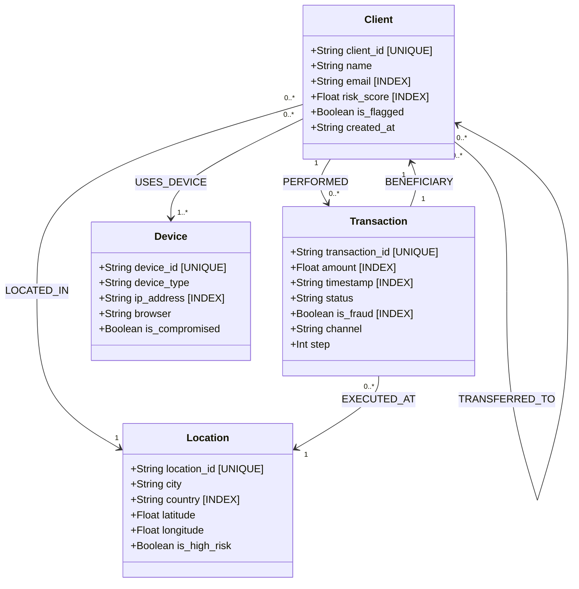
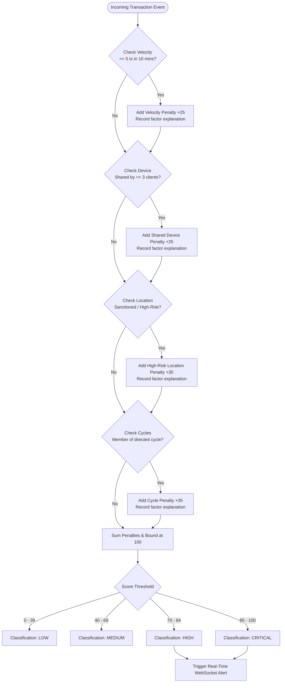
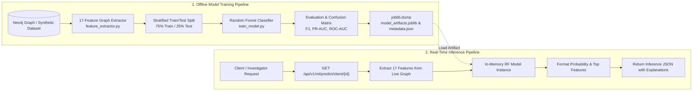
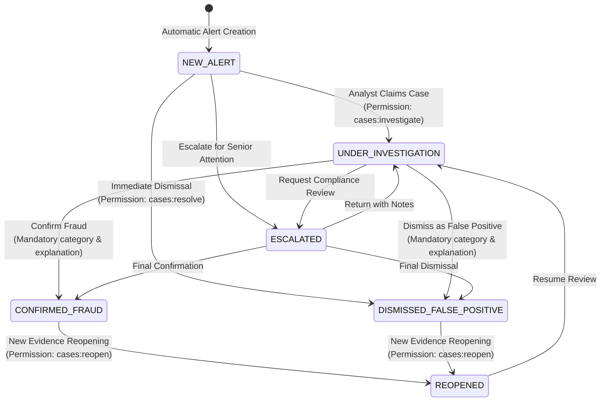
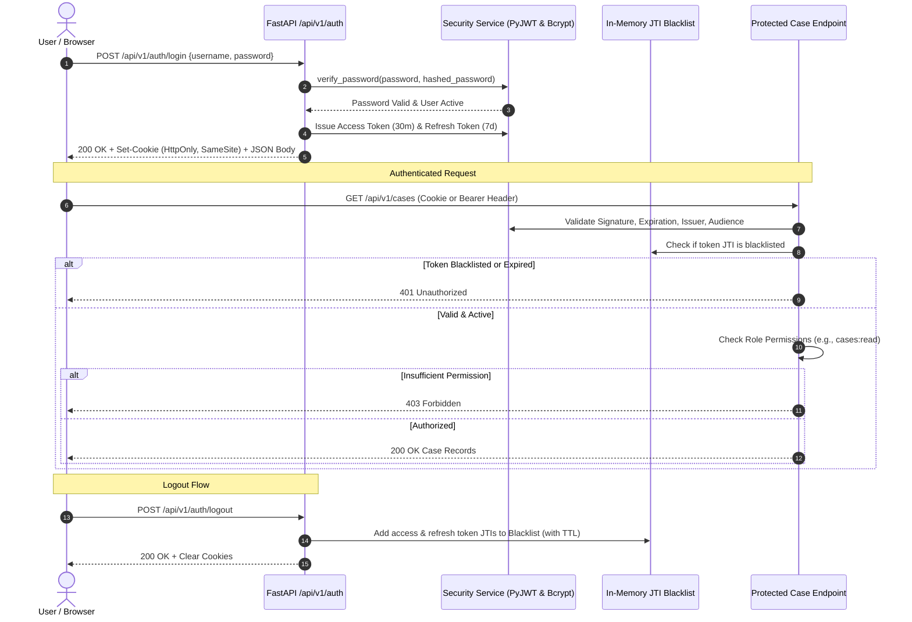
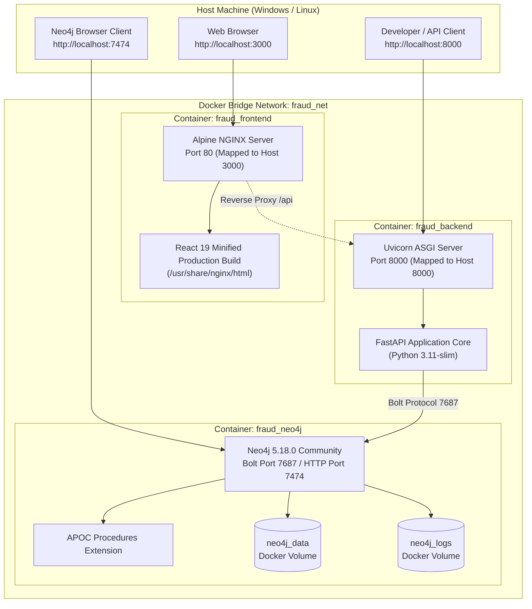

# Architecture and System Design Diagrams

**Project:** Real-Time Graph-Based Financial Fraud Detection & Risk Analysis Platform  
**Document:** System Architecture, Workflows & Data Models  
**Format:** Native Mermaid (Markdown Reproducible)

---

## 1. Overall System Architecture

The high-level architecture separates concerns into a Presentation & Visualization Layer (React 19), a Security & API Gateway Layer, an Asynchronous Backend Engine (FastAPI), and a Persistence & Analytics Tier (Neo4j, Joblib, In-Memory Store).

---

## 2. Transaction Ingestion & Real-Time Fraud Alert Data Flow

Shows how financial transaction events are ingested, scored against multi-factor graph rules, and broadcast to investigator interfaces.

---

## 3. Neo4j Property Graph Data Model

The data model captures relationships between Clients, Transactions, physical Devices, and Geolocation nodes.

---

## 4. Fraud Detection and Risk-Scoring Workflow

The deterministic rule engine evaluates 4 distinct risk dimensions and calculates an explainable composite score.

---

## 5. Machine Learning Training and Inference Workflow

Shows the feature extraction, model serialization, and real-time client inference flow.

---

## 6. Investigator Case Lifecycle (Finite State Machine)

The state machine enforcing valid transitions, concurrency version checks, and mandatory justifications.

---

## 7. Authentication and Authorization Protocol Flow

Shows user login, dual token issuance (cookies + JSON), request authentication, and token revocation.

---

## 8. Deployment and Infrastructure Architecture

Shows the containerized Docker Compose network isolating the database, application server, and web client.

