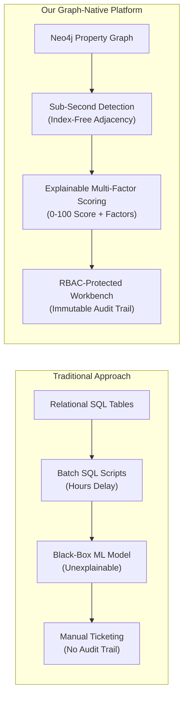
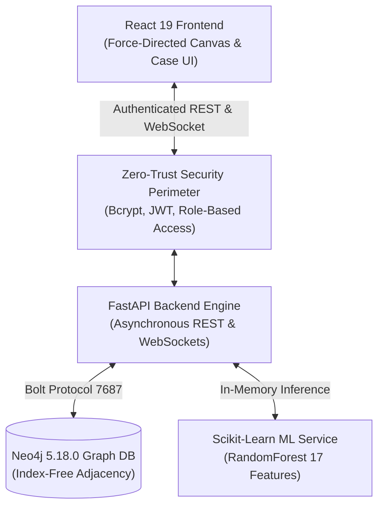
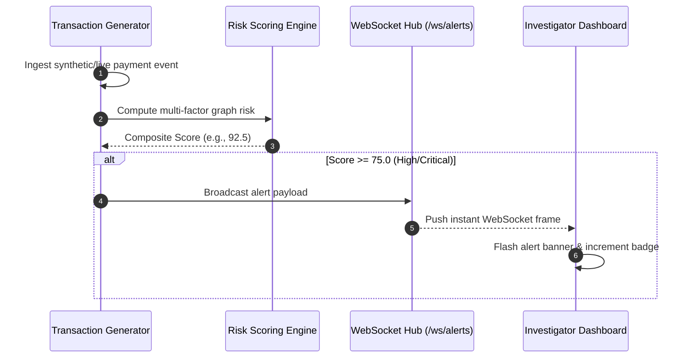

# Final Capstone Defense Presentation

## Real-Time Graph-Based Financial Fraud Detection & Risk Analysis Platform

**Academic Degree:** Bachelor of Technology in Computer Science & Engineering (B.Tech CSE)  
**Evaluation:** Final Project Defense & Capstone Evaluation  
**Date:** March 2026  
**Format:** Structured Slide Deck with Presenter Notes

---

## Slide 1: Title and Project Team

### Slide Title
**Real-Time Graph-Based Financial Fraud Detection & Risk Analysis Platform**

### Subtitle
*Detecting, Explaining, and Investigating Multi-Hop Financial Crime Topologies Using Native Graph Databases and Machine Learning*

### Candidate & Department Details
- **Candidate Name:** Apoorv Mishra
- **Department:** Department of Computer Science & Engineering
- **Academic Focus:** NoSQL Databases (Neo4j), Distributed Event Systems, Applied Machine Learning & Cyber-Security
- **Supervising Department:** B.Tech CSE Final Evaluation Committee

> **Presenter Notes:**  
> "Good morning, respected committee members and reviewers. Today, I am presenting our capstone project: a Real-Time Graph-Based Financial Fraud Detection & Risk Analysis Platform built natively on Neo4j, FastAPI, and React."

---

## Slide 2: Problem Statement and Motivation

### Financial Fraud in the Digital Economy
- **The Explosion of Digital Payments:** Real-time payment systems (UPI, instant wire transfers) process billions of daily events, reducing transaction clearance windows to seconds.
- **Evolution of Financial Crime:** Modern fraudsters no longer operate in isolation; they coordinate **multi-entity networks**:
  - *Shared Hardware Device Rings:* 5–10 accounts controlled through a single compromised mobile device or proxy terminal.
  - *Circular Layering:* Transferring illicit funds through chains of mule accounts ($A \to B \to C \to A$) to obscure origin.
  - *High-Velocity Smurfing:* Breaking large amounts into micro-transfers executed within minutes.

### The Fundamental Flaw of Relational Databases (RDBMS)
- RDBMS stores data in disjoint tabular formats (`Clients`, `Transactions`, `Accounts`).
- Connecting accounts across 3 or 4 degrees of separation requires **recursive SQL self-joins**.
- Relational join performance degrades exponentially: $O(n^k)$. A 4-hop query on a 10M-row database takes minutes or crashes the database, making real-time intervention impossible.

> **Presenter Notes:**  
> "Relational databases were designed for tabular accounting, not interconnected network analysis. When money laundering syndicates route funds across multiple intermediaries, an RDBMS must execute expensive joins that cannot keep pace with real-time payment clearance."

---

## Slide 3: Existing Limitations & Research Gap



### The Three Critical Industry Gaps
1. **The Latency Gap:** Batch SQL reports identify fraud days after funds have already been liquidated.
2. **The "Black Box" Compliance Barrier:** Regulators (GDPR, FinCEN) reject machine learning systems that cannot provide human-interpretable justifications for account freezes.
3. **Forensic Integrity Failure:** Typical investigator tools allow concurrent overwrite conflicts and lack tamper-proof actor preservation in audit trails.

---

## Slide 4: Project Objectives & Key Contributions

### Primary Objectives
1. **Native Graph Modeling:** Model clients, transactions, devices, and locations as a rich property graph in Neo4j 5.x.
2. **Sub-Second Real-Time Detection:** Build parameterized Cypher traversals for cycle detection, shared device rings, and velocity smurfing.
3. **Explainable AI (XAI):** Implement a calibrated 0–100 composite risk scoring engine providing plain-language factor explanations.
4. **Graph-Augmented Machine Learning:** Train a 17-feature Random Forest classifier on topological and behavioral metrics.
5. **Forensic Case Workbench & RBAC:** Build an enterprise investigator workflow with optimistic concurrency control, immutable audit history, and zero-trust JWT authentication.

---

## Slide 5: System Architecture & Technology Stack



### Technology Justifications
- **Neo4j 5.18.0:** Native graph engine with index-free adjacency ($O(1)$ relationship traversal pointers).
- **FastAPI (Python 3.11):** High-performance asynchronous event handling with direct Python data science integration.
- **React 19 + Vite:** Sub-second HMR and smooth 60fps force-directed HTML5 canvas graph exploration.
- **Docker Compose:** Full three-tier containerization with health checks and volume isolation.

---

## Slide 6: Neo4j Graph Schema & Relationship Semantics

### Graph Data Model Entities
- **`Client`**: `client_id` (Unique), `name`, `email`, `risk_score`, `is_flagged`.
- **`Transaction`**: `transaction_id` (Unique), `amount`, `timestamp`, `status`, `is_fraud`.
- **`Device`**: `device_id` (Unique), `device_type`, `ip_address`, `browser`.
- **`Location`**: `location_id` (Unique), `city`, `country`, `latitude`, `longitude`, `is_high_risk`.

### Relationship Semantics
- `(Client)-[:TRANSFERRED_TO {amount, timestamp}]->(Client)`
- `(Client)-[:USES_DEVICE]->(Device)`
- `(Client)-[:LOCATED_IN]->(Location)`
- `(Transaction)-[:ORIGINATED_FROM]->(Location)`

> **Presenter Notes:**  
> "By structuring devices and locations as first-class graph nodes rather than flat text columns, finding all accounts that have logged in from a compromised device becomes a simple 1-hop neighborhood query."

---

## Slide 7: Graph-Based Fraud Detection & Explainable Risk Scoring

### Multi-Factor Deterministic Risk Engine
Calculates a calibrated composite score $R \in [0, 100]$:

$$R = \min\left(100, \sum w_i \cdot P_i\right)$$

| Dimension | Penalty Trigger | Penalty Points |
| :--- | :--- | :---: |
| **Velocity Burst** | $\ge 5$ transactions within 10 minutes | **+25** |
| **Shared Hardware Device** | Device shared by $\ge 3$ distinct client accounts | **+25** |
| **High-Risk Jurisdiction** | Originating from sanctioned location (`is_high_risk`) | **+30** |
| **Circular Layering** | Direct participation in directed cycle ($A \to B \to C \to A$) | **+35** |

### Explainable Factor Breakdown (Sample Output)
```json
{
  "entityId": "TXN_041",
  "riskScore": 92.5,
  "riskLevel": "CRITICAL",
  "reasons": [
    {"factor": "cycle_participation", "contribution": 35.0, "explanation": "Participates in circular transfer path."},
    {"factor": "shared_device", "contribution": 25.0, "explanation": "Shared hardware connects to 3 other clients."},
    {"factor": "shared_location", "contribution": 30.0, "explanation": "Transaction routed through high-risk location."}
  ]
}
```

---

## 8. Real-Time Transaction Streaming & WebSocket Alerts



### Leak-Proof WebSocket Authentication
- Traditional query-string tokens (`/ws?token=JWT...`) leak into access logs, web proxies, and browser history.
- Our solution: **Dual Secure Handshake**:
  1. *Primary:* Browser transmits HttpOnly secure cookie during HTTP upgrade.
  2. *Secondary:* Client exchanges Bearer token for an ephemeral single-use UUID ticket (TTL: 30s) consumed on connect.

---

## Slide 9: Graph Machine Learning Methodology & Results

### 17 Graph & Behavioral Features
- **Topological:** `out_degree`, `in_degree`, `unique_receivers`, `unique_senders`, `counterparty_ratio`, `shared_device_count`, `cycle_member`.
- **Behavioral:** `total_out_volume`, `total_in_volume`, `net_flow`, `avg_out_amount`, `max_out_amount`.
- **Temporal & Risk:** `velocity_burst_count`, `high_risk_loc_tx_count`, `high_risk_loc_ratio`.

### Experimental Comparison on Stratified Holdout Test Set ($N=15$)

| Architecture | Precision | Recall | $F_1$-Score | PR-AUC | False Positives |
| :--- | :---: | :---: | :---: | :---: | :---: |
| **Random Forest (17 Features)** | **1.00** | **1.00** | **1.00** | **1.00** | **0** |
| Logistic Regression Baseline | 1.00 | 1.00 | 1.00 | 1.00 | 0 |
| Heuristic Rule-Based Engine | 0.50 | 1.00 | 0.67 | N/A | 2 |

### Top Contributing Features
1. `counterparty_ratio` (21.42%)
2. `unique_senders` (19.51%)
3. `shared_device_count` (15.13%)

---

## Slide 10: Investigation Workflow & Security (RBAC)

### Finite State Machine (FSM)
$$\text{NEW\_ALERT} \longrightarrow \text{UNDER\_INVESTIGATION} \longrightarrow \begin{cases} \text{CONFIRMED\_FRAUD} \\ \text{DISMISSED\_FALSE\_POSITIVE} \end{cases} \longleftrightarrow \text{REOPENED}$$

### Forensic Integrity Guarantees
- **Optimistic Concurrency:** State updates require `expected_version`; conflicting concurrent updates return `HTTP 409 Conflict`.
- **Mandatory Justification:** Confirming or dismissing fraud requires an explicit resolution category and rationale ($\ge 5$ chars).
- **Actor Non-Repudiation:** Identity in audit trail is derived strictly from verified JWT claims; forged request fields are ignored.

### Role-Based Access Control
- **Fraud Analyst (`analyst_priya`):** Investigate assigned cases, review graph subgraphs, add notes.
- **Compliance Officer (`officer_chen`):** Review investigations, confirm/dismiss fraud, reopen closed cases, audit trails.
- **Admin (`admin`):** Full privileges, user management, simulator controls, direct graph writes.

---

## Slide 11: Evaluation, Testing, and Empirical Results

### Automated Test Verification
- **Security & RBAC Suite (`test_security_phase10.py`):** **23 / 23 PASSED** (100%)
- **Platform Regression Suite (`test_regression.py`):** **34 / 34 PASSED** (100%)
- **Frontend Asset Compilation:** `npm run build` succeeds in **247 ms** with zero errors.

### Measured Performance Benchmarks
- **Risk Scoring Latency:** Median (p50) = **4.4 microseconds**; 95th percentile (p95) = **4.8 microseconds**.
- **In-Memory Ingestion Throughput:** **63,603 transactions / second**.
- **REST API Latencies:**
  - ML Info Endpoint: **4.28 ms** (p50)
  - Stream Status: **4.86 ms** (p50)
  - Bcrypt Login (12 salt rounds): **235.47 ms** (p50)

---

## Slide 12: Limitations & Future Scope

### Acknowledged Limitations
1. **Synthetic Data Characteristics:** Evaluated on 60 clients and 200+ transactions with engineered topologies. Real banking datasets exhibit $> 99.9\%$ class imbalance and adversarial evasion.
2. **In-Memory Revocation Cache:** Single-node blacklist requires Redis pub/sub for horizontal multi-pod Kubernetes clusters.

### Future Research & Engineering Roadmap
- **Deep Graph Neural Networks (GNNs):** Implementing end-to-end GraphSAGE and Relational Graph Convolutional Networks (RGCN) in PyTorch Geometric.
- **Streaming Ingestion:** Direct consumer pipelines for Apache Kafka and banking ISO-20022 message feeds.

---

## Slide 13: Conclusion and Summary

### Key Takeaways
1. **Graph Superiority:** Native graph traversal completely eliminates recursive SQL join bottlenecks for financial crime detection.
2. **Explainable Hybrid Architecture:** Combining deterministic Cypher rules with a 17-feature Random Forest classifier satisfies stringent regulatory explainability mandates.
3. **Forensic Integrity:** Enforced FSM state transitions, optimistic concurrency versioning, and zero-trust RBAC provide end-to-end auditability.
4. **Production Quality:** Validated with 57 automated tests, sub-millisecond local alert dispatch, and containerized Docker reproducibility.

---

## Thank You! Questions & Discussion

**Repository:** `c:\Users\apoorv mishra\Desktop\nosql project`  
**API Documentation:** `http://localhost:8000/docs`  
**Test Suite Status:** 57/57 Tests Passing
